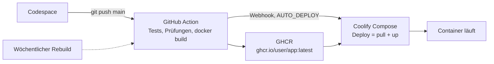

# Betriebshandbuch: GitHub → GHCR → Coolify

Abläufe für Menschen: einmalige Einrichtung, neue App in Coolify, Deploy, Rollback, PHP-Updates. Die Regeln, an die sich Claude beim Programmieren hält, stehen in `STANDARDS.md`.

## Prinzip



Coolify baut nie selbst. Es kennt nur das Compose aus `deploy/docker-compose.coolify.yml` mit fertigen Images; „Deploy“ heißt `docker compose pull && docker compose up -d`. PostgreSQL ist eine eigene Coolify-Ressource. Schlägt ein Build fehl, bleibt das alte `latest` in GHCR unverändert – es kann nie ein halbfertiges Image in Produktion landen.

## Einmalige Einrichtung

### GHCR-Zugriff für den Coolify-Server

Private Images kann der Server nur ziehen, wenn Docker angemeldet ist. GitHub Personal Access Token (classic) mit genau dem Scope `read:packages` anlegen (Name `coolify-pull`, Ablauf 1 Jahr mit Kalendereintrag), dann per SSH auf dem Server:

```bash
echo '<PAT>' | docker login ghcr.io -u <github-user> --password-stdin
```

Gilt für alle Compose-Deployments auf diesem Server. Images nicht auf „public“ stellen, wenn die App Kunden-, Spender- oder Personendaten verarbeitet.

### Coolify-API-Token für Auto-Deploy

Coolify → Keys & Tokens → API tokens: Token mit Berechtigung `deploy`. In jedem Repo als Secret `COOLIFY_TOKEN`; pro App kommt die Webhook-URL als Secret `COOLIFY_WEBHOOK` und die Variable `AUTO_DEPLOY=true` dazu.

```powershell
gh secret set COOLIFY_TOKEN -R roberteinsle/<app>
gh secret set COOLIFY_WEBHOOK -R roberteinsle/<app>
gh variable set AUTO_DEPLOY -R roberteinsle/<app> --body true
```

### Codespaces

GitHub → Settings → Codespaces: Idle timeout 30 Minuten, Retention 7 Tage. Das kostenlose Kontingent (120 Core-Stunden/Monat) reicht für Feierabendprojekte; Verbrauch unter Settings → Billing.

### Sicherheitsmeldungen zu PHP

RSS-Feed von php.net (Releases) abonnieren und im Repo `php/php-src` Watch → Custom → Security alerts aktivieren. Bei einer kritischen Meldung: PHP-Update, Fall A.

### Cloudflare Access für Admin-Bereiche

Für jede öffentlich erreichbare App:

1. Zero Trust → Access → Applications → Self-hosted: Domain der App, Pfad des Admin-Bereichs (z. B. `/admin`).
2. Policy: Allow, nur die E-Mail-Adressen der Admins (bei Apps mit weiteren Admins alle eintragen).
3. Server so absichern, dass Web-Verkehr nur über Cloudflare ankommt (Cloudflare Tunnel oder Firewall nur für Cloudflare-IP-Bereiche).
4. Testen: Admin-Pfad im privaten Fenster öffnen → Cloudflare-Anmeldung muss erscheinen.

## Neue App in Coolify

1. Projekt → Environment `production` → New Resource → PostgreSQL. Interne URL notieren, Backup aktivieren (täglich, Ziel S3).
2. New Resource → Docker Compose Empty; Inhalt von `deploy/docker-compose.coolify.yml` einfügen, speichern.
3. Environment Variables setzen: `APP_IMAGE` (`ghcr.io/<github-user>/<app>`), `APP_KEY` (`php artisan key:generate --show`), `APP_URL`, `DB_HOST` (interner Hostname der PostgreSQL-Ressource), `DB_DATABASE`, `DB_USERNAME`, `DB_PASSWORD`, `ADMIN_EMAIL`, Mail. `APP_TAG` leer = `latest`.
4. Beim Service `app` Domain setzen und internen Port `8080`. Coolify übernimmt TLS.
5. DNS: Eintrag auf den Coolify-Server bzw. Cloudflare.
6. Deploy. Prüfen: `https://<domain>/up` liefert 200, `php -v` im Container zeigt die gepatchte Version.
7. Webhook-URL der Ressource als `COOLIFY_WEBHOOK` ins Repo, `AUTO_DEPLOY=true` (siehe oben).
8. Öffentlich erreichbar? → Cloudflare Access für den Admin-Pfad.
9. Ersten Release-Tag `v0.1.0` setzen, sobald die App etwas Sinnvolles tut.

## Deploy im Alltag

Push auf `main` → Action grün → Coolify deployt per Webhook (oder Deploy-Klick). Migrationen laufen beim Containerstart; die App ist dabei wenige Sekunden nicht erreichbar.

Compose geändert (neuer Dienst, neues Volume): Änderung committen, Inhalt in Coolify einfügen, speichern, Deploy – der einzige manuelle Doppelschritt.

## Image-Tags und Releases

| Tag | Entsteht bei | Wofür |
|---|---|---|
| `latest` | jedem Push auf `main` und jedem wöchentlichen Rebuild | Produktion |
| `sha-a1b2c3d` | jedem Build | Rollback auf einen exakten Commit |
| `1.4.2` und `1.4` | Git-Tag `v1.4.2` | bewusste Releases |

```bash
git tag -a v1.4.2 -m "Kurze Beschreibung"
git push origin v1.4.2
```

Release setzen vor größeren Änderungen, vor Schema-Wechseln und nach einem PHP-Minor-Wechsel.

**Aufräumen:** GHCR behält alle Tags unbegrenzt. Pro Package einmal Retention einrichten (Package → Settings, oder `actions/delete-package-versions` für `sha-*`-Tags älter als 90 Tage).

## Rollback

In Coolify `APP_TAG` auf einen älteren Tag setzen (`sha-a1b2c3d` oder `1.4.1`), Deploy. Zurück auf aktuell: `APP_TAG` leeren, Deploy.

- Migrationen werden nicht zurückgerollt; über eine Migration hinweg erst das DB-Backup einspielen.
- Ein älteres Image enthält auch die ältere PHP-Version seines Build-Zeitpunkts. Nie auf ein Image mit ungepatchtem PHP zurückrollen (z. B. vor dem 21.10.2026, PHP2Shell CVE-2026-109618/109619).

## PHP-Updates

Die PHP-Version steht an drei Stellen: `Dockerfile` (`ARG PHP_VERSION`), `composer.json`, `.devcontainer/devcontainer.json`.

### Fall A: kritische Sicherheitslücke im Patch

Ziel: alle Apps am selben Tag gepatcht.

1. Prüfen, ob serversideup das gepatchte Image veröffentlicht hat (Docker Hub, Tag `8.5-fpm-nginx-alpine`).
2. Je Repo den Build ohne Cache starten:
   ```bash
   gh workflow run build.yml -R roberteinsle/<app> -f no_cache=true
   ```
3. Im Action-Log „PHP-Version im Image ausgeben“ prüfen.
4. Deploy (oder Auto-Deploy abwarten), dann `php -v` im Container.
5. Alte, ungepatchte `sha-*`-Images in GHCR löschen.

### Fall B: Patch, nicht kritisch

Nichts tun. Der wöchentliche Rebuild holt ihn, das nächste Deploy rollt ihn aus.

### Fall C: neue Minor-Version (planmäßig Ende November)

Ziel: innerhalb von 4 Wochen auf allen Apps.

1. Warten, bis serversideup das Image anbietet und Laravel die Version offiziell unterstützt.
2. Branch `php-8.x`, an den drei Stellen ändern, im Codespace `composer update` und Tests, Deprecations beheben.
3. Merge nach `main`, Release-Tag (Minor-Sprung), Deploy, `php -v` prüfen.
4. Version in `STANDARDS.md` und in `app-template` aktualisieren.
